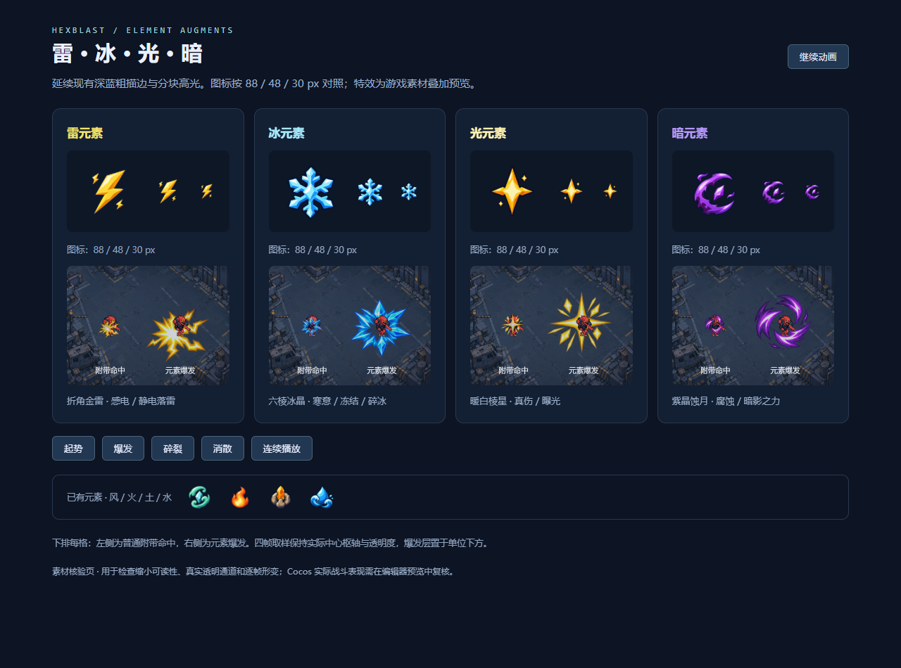
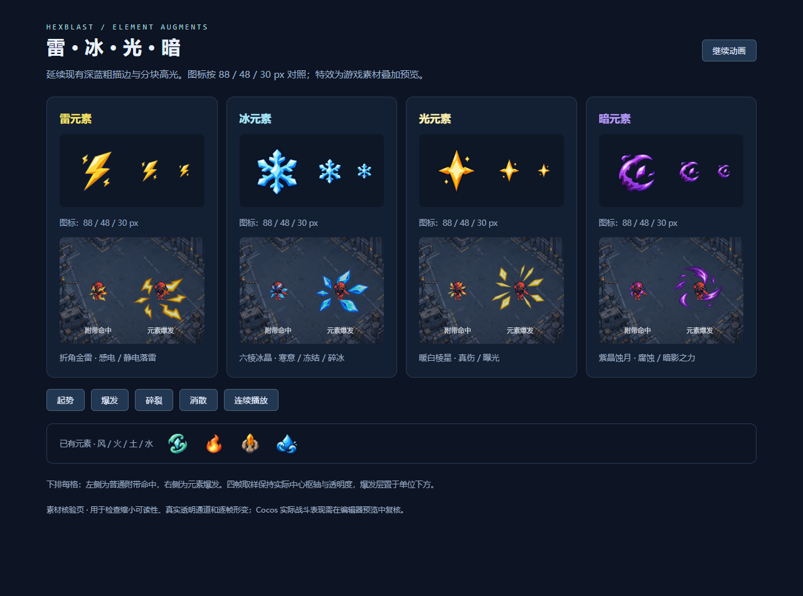

# 元素扩展图标与特效（2026-11-16）

当前实现已有风/火/土/水四种正式图标；本批补齐雷/冰/光/暗，保留已有元素及工作区中的卡牌碎裂改动。数值、售价、层数、伤害范围和元素暴击触发条件均沿用现有逻辑。

## 设计与资源

沿用 `ui_icon_hex21` 的深蓝粗轮廓、饱和色块、分面高光与透明底；稀有度继续交给 UI 边框表达。使用内置 `image_gen` 生成四张独立图标和一张特效图集，提示词原文在 [prompts.json](prompts.json)。原始生成图保留在 Codex 生成目录，项目使用的五张图已复制入库，未进行色键抠图或二次改绘。

| 元素 | 项目资源 | 图标语义 | 特效接线 |
|---|---|---|---|
| 雷 | `assets/resources/art/ui_icon_hex35.png` | 金色折角雷芯与两枚电火花 | 感电命中、静电落雷、死亡引雷目标 |
| 冰 | `assets/resources/art/ui_icon_hex36.png` | 六棱雪晶与中心棱核 | 寒意命中、冻结/寒潮、暴击碎冰 |
| 光 | `assets/resources/art/ui_icon_hex37.png` | 金白四角棱星 | 普通光伤、曝光强闪 |
| 暗 | `assets/resources/art/ui_icon_hex38.png` | 紫色蚀月与悬浮晶片 | 腐蚀命中、击杀腐蚀目标、暗影之力 |

四张图标为 1254×1254 RGBA，覆盖同名 PNG，原 UUID 保留；同步更新 meta 尺寸、裁切范围及顶点。`assets/resources/art/anim_fx_element_augments.png` 为新增 1254×1254 RGBA 四行四列图集，行序为雷/冰/光/暗，按现有动画系统使用 313.5px 切片与中心枢轴，禁止动态合图。

每行四帧依次为起势、爆发、碎裂、消散。普通附带命中显示约 40px、持续 0.2 秒；强化爆发显示 64～122px、持续 0.36 秒，范围效果位于单位下方。冰晶与暗蚀保留中空轮廓，避免遮住单位。

`ParticleManager.elementImpact` 合并同元素、38px 内的高频命中；爆发可替换普通命中，总元素贴图上限 12 份，继续使用现有节点池。无新增持续粒子、计时器或常驻节点。落雷/碎冰共用原范围伤害逻辑，材质和声音分别改成雷弧/冰晶与 lightning/freeze。

## 验证

- `npm test`：842/842 通过，包含四项新增元素视觉回归；覆盖未装备元素暴击时的反馈、范围伤害与墙体遮挡、冻结/碎冰特权、1000 次高频请求上限及清场恢复。
- `npm run typecheck`：通过。
- [资源验证数据](art-validation.json)：五张图片 RGBA、透明四角、图标 UUID 和 16 个非空切片；图集切片边界最大 alpha 为 2/255，无可见跨格像素。
- Playwright 素材核验：图标按 88/48/30px 对照，检查爆发/碎裂/消散三个阶段、图片加载及透明叠加。入口为 `tools/element-review.html`，可通过 `python tools/serve_combat_review.py` 启动后打开 `http://127.0.0.1:8316/tools/element-review.html`。
- 本批未在 Cocos 编辑器中运行实际战斗；编辑器资源导入和战斗密度效果仍需实机复核。

素材预览（不是 Cocos 实机截图）：

临时日志与浏览器快照已清理，正式素材、验收截图和复核工具随代码保留。
