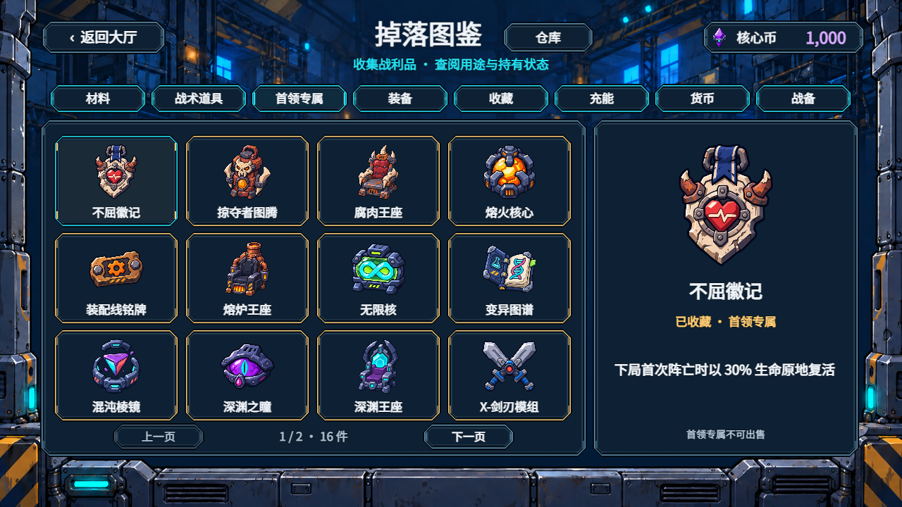
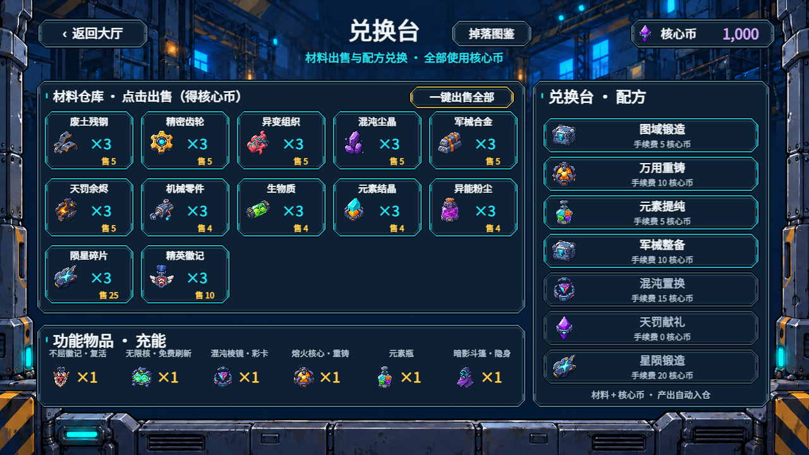
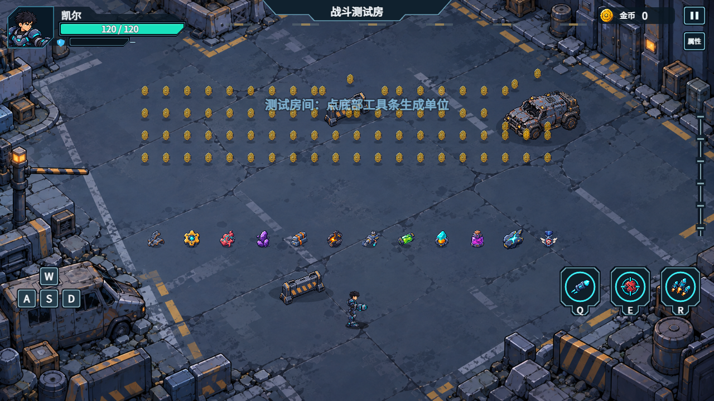

# 全掉落物画风统一

制作：2026-11-06；最终验收：2026-11-09。参考：[A 造型与 B 亮度方案](../../style-a-with-b-brightness-plan-2026-09-30.md)与其中的参考图 A。

## 范围

来源为用户提供的「掉落物清单v3.xlsx」六个工作表，并逐项核对 `DropDB`、`EquipmentDB`、`Economy`、`DepotCatalog`、`SaveSystem` 和实际展示代码。表格标题的“15 种材料”含三种即时物品，去重后是 12 种入仓材料；“34 条道具”另加幸运物和两种金袋，代码实际 37 条。首领专属按实际代码为 16 件，其中王座 4 件；不虚构尚未实现的另两座王座。

共 86 个独立原画身份：12 种材料、37 种道具、16 件首领专属、6 类装备、玩偶猴、2 种货币、元素瓶与完整暗影斗篷、4 类军需战备、6 种波间补给。`core_revive`、`core_reforge`、`core_refresh`、`core_prism` 四类充能复用对应首领原物的图，避免同物入仓后变形。

## 设计

- 全部使用内置 imagegen，参考 A 的深蓝厚轮廓、简化工业科幻造型、明确的二至三段明暗。光源统一左上，主要材质有大块浅色受光面；控制微小零件和泛光。
- 材料保留各自实物轮廓；战术道具体现来源怪物的组织或机械构造；首领专属与对应章节的废土、熔炉、实验室、虚空、军械、天罚主题对应。
- 按 v3 清单，金币采用金黄圆币，核心币采用紫色菱钻；名字、形状、色彩共同区分。装备品质由原有框色及品质文字表达，不重新染色原画。
- 全部导入为 512×512 RGBA，实体适配 464×464 内框，四周至少 24 像素透明边距；保留原始长宽比。现有金币覆盖同名 PNG，保留原 UUID；其余新增独立文件及 `.meta`，不改旧文件名。

## 展示覆盖

| 位置 | 接入内容 |
|---|---|
| 战场地面 | 金币、12 材料、37 道具及收藏、玩偶猴；特殊物品独立节点池，轻微漂浮和到期闪烁 |
| 战场即时入仓奖励 | 首领专属、装备、核心币保底包和保底材料短暂显示实物；入档时机保持原规则 |
| 道具部署 | 诱饵假人使用假人本体；不改变召唤物现有行为与数值 |
| 战斗 HUD | 圆形金币与余额 |
| 海克斯商店 | 圆形金币钱包；已优化海克斯图标保持原资源 |
| 波间补给商店 | 6 种补给独立图标、圆形金币钱包与明确币种价格 |
| 仓库 | 出战槽、品质筛选、分页格、详情、卖出钱包；补齐高频刃原画与攻速标签，容量随六词缀推导 |
| 军需商店 | 四类商品卡、详情、已购战备与紫色核心币钱包 |
| 兑换台 | 12 材料格、六类充能、配方产出及核心币钱包 |
| 掉落图鉴 | 从仓库/军需/兑换台直接进入；8 类筛选、每页 12 件、详情、库存及首领/收藏状态；完整暗影斗篷与碎片分别显示 |
| 成就奖励 | 同款紫色核心币图标及解锁明暗状态 |
| 通关与阵亡结算 | 两种货币原画及“剩余金币 → 核心币 ×N”兑换行 |

## 文件与复现

- 运行时身份：[DropVisualDB.ts](../../../../assets/scripts/data/DropVisualDB.ts)。各名称与效果从正式数据表获取，不单独复制掉落参数。
- 提示词主体：[subjects.json](subjects.json)。完整公共提示词和金币提示词见 [prompts.json](prompts.json)；图片由内置工具生成，导入脚本只做尺寸归一、透明度检查和元数据登记。
- 原始来源与哈希：[sources.json](sources.json)；最终资源、UUID、尺寸和 SHA-256：[production.json](production.json)。原始高分辨率生成图保留在来源路径，游戏依赖的最终文件全部在仓库内。
- 资源导入：`node tools/import_drop_art.cjs`。`DROP_SHARP_MODULE` 可指定本机 sharp 模块；已有 UUID 不重建。
- 只读运行核验：先 `npx tsc -p tsconfig.test.json`，再 `node tools/serve_drop_review.cjs`；打开 `http://127.0.0.1:8326/game/` 或 `/drop-review`。核验服务复用已有 Cocos 3.8.8 引擎、编译当前 TS 源码，使用当前 PNG；不改 `build/`、`library/`、`temp/` 等生成目录。该服务是本地验收工具，不随游戏发布，也不代替正式发布时 Creator 的资源导入构建。

## 验证

- 全量测试：768/768 通过；类型检查通过；git diff --check 通过。修改前基线为 763/763。
- [表格逐行覆盖](coverage-audit.json)：65 个物品名称全部匹配原画，另补充代码中的 21 个身份，共 86 件；4 类首领充能共享原物身份。
- [资源检查](art-validation.json)：86 张 512×512 RGBA，真实透明通道、透明边距和独立内容检查全部通过；[production.json](production.json) 的 SHA-256 与当前 PNG 一一核对。原金币 UUID 与 Git 原版一致。
- [Cocos 运行核验](browser-validation.json)：11 页图鉴，86 件逐件选择及图片加载；六章分别展示 15/15/15/15/15/11 件，全部可见；仓库、军需、波间商店、充能、部署假人、首领即时奖励、成就与两种结算均已截图复核。
- 密集测试：100 个逻辑金币沿用既有 80 节点显示预算，12 个特殊物品全部可见；3 件即时奖励全部加载。退出后金币/特殊物品显示节点均为 0，测试档案已恢复，控制台无错误或警告。
- 兑换台已调整面板与配方间距；1280×720、1600×720 实际画面均无页头遮挡、配方重叠或物品拉伸。
- 未重新执行 Creator 发布构建；运行核验使用当前源码与已有 3.8.8 引擎，不修改编辑器生成目录。代码、素材与文档均保留待提交状态。

## 预览

[材料](gallery-materials.png) · [战术道具](gallery-consumables.png) · [首领专属](gallery-boss-uniques.png) · [六类装备](gallery-equipment.png) · [收藏](gallery-collections.png) · [充能](gallery-charges.png) · [货币](gallery-currencies.png) · [补给与战备](gallery-supplies.png)

