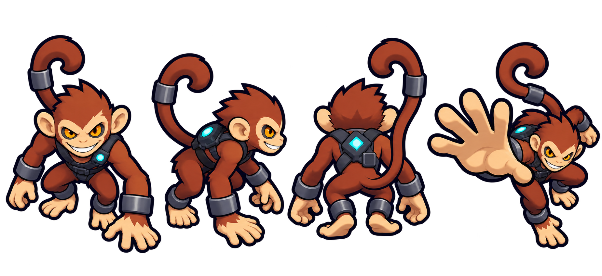

# 滑稽猴：形象与身体动作设计（第一轮）

日期：2026-10-12。范围：测试房彩蛋 Boss `joker` 的本体形象、身体动作、攻击特效与接入。技能数值和命中规则保持原样。

## 依据与定位

- 延续 [A 造型、B 亮度方案](../../style-a-with-b-brightness-plan-2026-09-30.md)：高位四分之三视角，深蓝粗轮廓，圆整且结实的体块，少量分块明暗；重要识别点在实际战斗尺寸下清楚。
- `BossDB.TEST_BOSSES` 将滑稽猴归为 `boss`，但设定为小体型、快速、贴脸恶作剧。它是有意小于其他首领的体形例外，不能直接套用通常首领的 140–155 逻辑像素标准。建议先以可见本体约 90–105 逻辑像素验收，并以玩家、通用小 Boss 和其他首领同屏复核。
- 角色语义是废土实验场里的狡黠生物，而非马戏团小丑。视觉上以猴脸、卷钩尾、夸张巴掌三处建立识别，背部青色小装置提示恶作剧技能。

## 造型规格

| 部位 | 设计与动作用途 |
| --- | --- |
| 头脸 | 宽耳、奶油色口鼻、琥珀眼和偏斜咧嘴。正面即使缩小也应能辨认眼与嘴；侧面保留突出的口鼻。 |
| 身体 | 约三头身，短躯、低重心、弹簧式屈膝。红棕主体配深蓝束带，与红色腐肉小兵区分。 |
| 手掌 | 大而扁的浅色掌面；耳光前摇先露掌面，再迅速横扫。手指合并成几块，不逐根描小关节。 |
| 尾巴 | 单一粗卷钩轮廓，末端弯向头部上方；移动时滞后摆动，背面也不遮住头。 |
| 装置 | 背带上仅一块青色亮点。恶作剧动作才短暂提亮，不用常亮光晕吞掉身体。 |
| 护具 | 深蓝束带与大块钝圆腕箍；不加帽子、红鼻、碎布或密集金属装饰。 |

主色建议：毛发赭棕 `#A64A2D`，亮面暖橙 `#C86A3D`，口鼻/手掌奶油色 `#F4C486`，轮廓深蓝 `#10192B`，腕箍灰蓝 `#414D63`，眼金 `#F5A728`，装置青 `#49D7E7`。最终色值以游戏地图上的同屏可读性调整。

## 三方向和动作设计

正、侧、背共用同一身体比例、脚底锚点与尾巴体积；侧面镜像可作为另一侧。每个方向需有待机、移动、快速奔跑、跳跃、普通攻击、受击、倒地，以及下列三个技能姿势。局部关节动画优先，只有巴掌峰值与倒地需要明显姿势变形。

| 玩法动作 | 身体动作节奏 | 阅读重点 |
| --- | --- | --- |
| 上蹿下跳 | 蹲低压缩 → 身体带四肢离地 → 尾巴滞后甩动 → 快速步态 | 加速期间实际追逐速度提高 50%；贴身时沿接触圆弧左右侧跳，不穿过玩家。 |
| 滑稽恶作剧 | 一手指向玩家，另一手碰背带装置；躯干侧倾，装置短促闪亮后回到待机 | 与耳光分开：手掌闭合、不做挥击；四种减益共用身体动作，现有文字与暗角负责区分结果。 |
| 滑稽耳光 | 掌面外翻并明显后撤 → 肩部带动横扫 → 大掌短暂停在命中方向 → 收臂 | 掌面是前摇识别点；峰值对应现有伤害与眩晕时刻，不重做命中特效。 |
| 受击 / 倒地 | 耳朵和头后仰、尾巴先失衡；倒地时四肢打开、尾巴松卷 | 和主动跳跃分清，避免被误读为再次加速。 |

## 已制作并接入

- 透明分件源稿：[boss_joker.png](../enemy-redesign/rigs/boss_joker.png)，正、侧、背各六件。三方向动作图集 `anim_stylea_boss_joker_front/side/back` 各为 2048×2560，8 帧×10 行；[动作总览](../enemy-redesign/qa/boss_joker-contact.png)、[三技能对照](../enemy-redesign/qa/boss_joker-skills.png)与[起跳/耳光逐帧检查](../enemy-redesign/qa/boss_joker-motion.png)可检查轮廓、肩关节和姿势。
- `enemy_boss_joker.png` 是 512×512 静态回退图。`BossDB.TEST_BOSSES` 已指向该 key，并取消金黄染色。小体型例外约 90–105 逻辑像素，碰撞半径和技能数值仍由原数据控制。
- `anim_fx_joker_trick.png` 用于冲刺启动与恶作剧命中；`anim_fx_joker_slap.png` 用于近战挥掌。两张均为透明四帧图集，动画和资源元数据已经登记。
- 三技能触发时分别切换 `skill`、`skill2`、`skill3` 动作。结算当帧对齐动作爆发帧；现有伤害、减益与玩偶猴掉落逻辑不变。
- 2026-10-12 截图反馈修正：近侧手臂围绕三方向各自的肩关节转动，不再平移独立手掌；上蹿下跳的 50% 加速已接入实际位移，并在贴身时左右侧跳。
- 侧面实机截图复核：前臂根部进一步压入肩部体块，手掌下旋以露出面部；正面肩关节也加深搭接。[侧面肩臂对照](../enemy-redesign/qa/boss_joker-side-connection.png)涵盖待机、移动、起跳和耳光，逐帧检查见上方动作图。

现有 `anim_hit_units_10` 仍是玩家受击时的程序化占位命中图，后续可单独重绘。当前以图集对照、资源校验、运行时 headless 测试验收；仍需在 Cocos Creator 的 1280×720 测试房预览中检查正/侧/背切换、密集战斗辨识、贴身碰撞与实际加载效果。

生成方式：内置 ImageGen 制作新角色概念稿，再以同一稿做一次收简编辑；最终保留 `joker-concept-v2.png`。原始提示词要点为“废土科幻动作卡通、高位四分之三视角、深蓝粗轮廓、赭棕猴身、奶油色口鼻与大掌、卷钩尾、少量青色背带装置、正侧背同体形和耳光姿势、透明背景”；第二轮仅收简细节并对齐比例。
